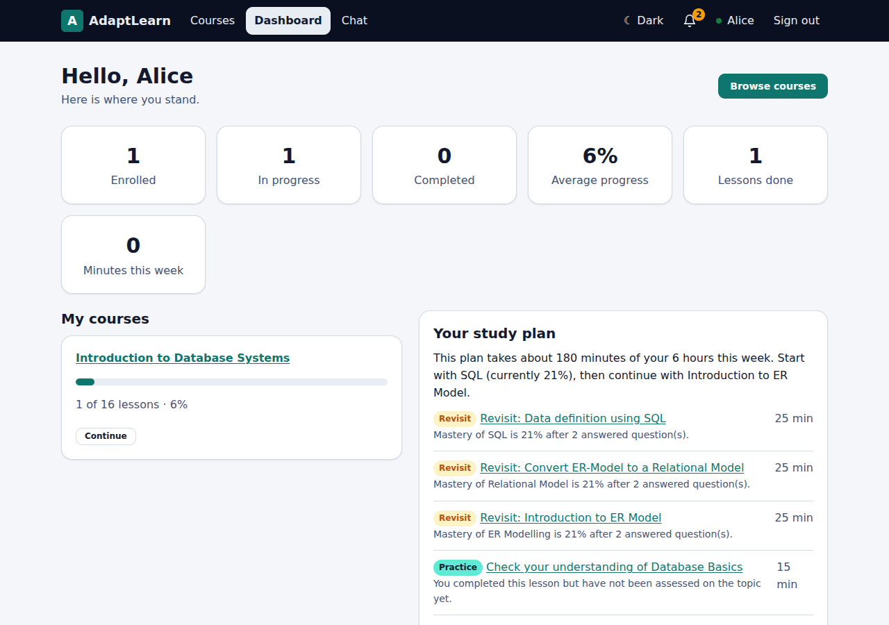
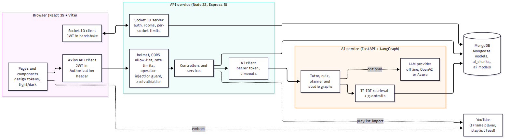

# AdaptLearn: Student Course Management and Learning Portal

A full-stack learning platform: students enrol in video courses, track progress, take graded quizzes, get an **adaptive study plan**, ask an **AI tutor that only answers from the course material**, and chat live with classmates. Administrators manage courses, lessons, students and quizzes, import YouTube playlists, and see which students need help.

| Layer | Technology |
|---|---|
| Web client | React 19, React Router 7, Vite 8, Socket.IO client, three-layer design tokens (light/dark, WCAG AA) |
| API | Node 22, Express 5, Mongoose 9 (MongoDB), JWT, bcrypt, zod, helmet, Socket.IO 4 |
| AI service | Python 3.12, FastAPI, **LangGraph**, TF-IDF retrieval, guardrails, optional OpenAI/Azure OpenAI |
| Database | MongoDB 7 (Atlas in production) |
| Quality | 204 automated tests, 39 real-browser steps, 78-request Postman/Newman run, CI on GitHub Actions |



## Features

**Students:** register/sign in, browse and search courses, enrol/unenrol, watch lessons (YouTube) with notes and resume, mark progress, take quizzes graded on the server, see a study plan that revisits weak topics first, ask the AI tutor (answers cite their lesson, off-topic questions are declined), course chat rooms and direct messages, instant notifications, light/dark theme.

**Administrators:** dashboard with statistics, *students at risk* and *content gaps* (questions the tutor could not answer), course and lesson editor with publish/unpublish, student management, announcements to everyone or one course, a quiz editor (write quizzes, or review and edit AI-generated **drafts** before students see them), Course Studio (turn a YouTube playlist into a course, or attach videos to existing lessons).

## Architecture



Details: [`docs/architecture.md`](docs/architecture.md) · data model and ER diagrams: [`docs/data-model.md`](docs/data-model.md) · REST and Socket.IO reference: [`docs/api-spec.md`](docs/api-spec.md).

## Quick start

### Option A: Docker (one command)

```bash
cp .env.example .env          # fill JWT_SECRET, AI_SERVICE_TOKEN, ADMIN_PASSWORD (12+ chars)
docker compose up --build     # web on http://localhost:8080
```

### Option B: run the three services yourself

Prerequisites: Node 22+, Python 3.12+, MongoDB 7 running locally (or an Atlas URI).

```bash
npm run install:all                                   # server, client, e2e, postman dependencies
pip install -r ai-service/requirements.txt

cp server/.env.example server/.env                    # set JWT_SECRET (32+ bytes), ADMIN_PASSWORD, AI_SERVICE_TOKEN
cp ai-service/.env.example ai-service/.env            # AI_SERVICE_TOKEN must match the API's
# In server/.env, for the first run only:  SEED_ON_BOOT=true   SEED_DEMO_USERS=true

npm run dev:ai        # terminal 1: AI service on :8000
npm run dev:server    # terminal 2: API on :5000 (seeds 3 courses on first boot)
npm run dev:client    # terminal 3: web app on http://localhost:5173
```

Generate a secret with `node -e "console.log(require('crypto').randomBytes(48).toString('base64'))"`.

**Sign in as:** the admin you configured in `ADMIN_EMAIL` / `ADMIN_PASSWORD`; with `SEED_DEMO_USERS=true`, also `demo.student@adaptlearn.dev` and `priya.classmate@adaptlearn.dev` (password `Student-Demo-2026!`, override with `DEMO_PASSWORD`). Demo users are off by default because they have a known password.

The AI features work **without any API key** (offline mode). The API and web app also run without the AI service; the tutor, planner and AI quiz then report "unavailable" and everything else keeps working.

### Videos

Seeded courses use the real NPTEL-NOC IITM lecture titles but **do not ship video IDs** (they cannot be verified offline). Open *Admin → Manage courses → Introduction to Database Systems → Attach videos from a YouTube playlist* and paste the playlist URL; videos are matched to lessons by title.

## Commands

| Command | What it does |
|---|---|
| `npm run test:server` | 89 API tests against a real MongoDB (needs `mongod` on 27017, or set `MONGO_URI_TEST`) |
| `npm run test:ai` | 87 AI-service tests (includes a MongoDB store test) |
| `npm run test:client` | 28 component and guard tests |
| `npm run lint:tokens` | fails if CSS hard-codes colours or spacing, or `tokens.css` is stale |
| `npm run eval:ai` | regenerates `docs/evaluation-results.md` |
| `npm run test:e2e` | boots everything and drives a real browser with two simultaneous users and an admin (39 steps, screenshots to `docs/screenshots`) |
| `npm run test:postman` | boots API + AI and runs the 78-request Postman collection with Newman |
| `npm run build:postman` | regenerates the collection from `postman/build-collection.mjs` |

`npm run test:e2e` needs `pip install -r ai-service/requirements.txt`, MongoDB, and uses `E2E_PYTHON` if your Python is not `python3`/`python`.

## Project layout

```
client/        React app  (src/pages, src/components, src/context, design-tokens.json -> src/styles/tokens.css)
server/        Express API (src/models, controllers, services, middleware, sockets, validators, scripts/seed.js, tests/)
ai-service/    FastAPI + LangGraph (app/graphs, services, guardrails, eval/, tests/)
e2e/           real-browser tests + the orchestrator that boots the stack
postman/       generated collection and environment
docs/          architecture, data model, API, security, deployment, testing, AI design, user guide, checklist
frontend-static/  static HTML/CSS/JS prototype (unchanged, mock data)
```

## Documentation index

| Document | Contents |
|---|---|
| [`docs/gap-analysis.md`](docs/gap-analysis.md) | The task list: what was found, what was done, what remains |
| [`docs/submission-checklist.md`](docs/submission-checklist.md) | Tasks mapped to evidence |
| [`docs/architecture.md`](docs/architecture.md) | Components, flows, design decisions, failure behaviour |
| [`docs/data-model.md`](docs/data-model.md) | Collections, indexes, ER diagrams, mastery formula |
| [`docs/api-spec.md`](docs/api-spec.md) | All 58 REST endpoints and the Socket.IO events |
| [`docs/security.md`](docs/security.md) | Threat model, controls, how each is tested, known limitations |
| [`docs/ai-design.md`](docs/ai-design.md) | LangGraph pipelines, retrieval, guardrails, providers, limits |
| [`docs/evaluation-results.md`](docs/evaluation-results.md) | Measured AI quality (regenerated by `npm run eval:ai`) |
| [`docs/testing.md`](docs/testing.md) | Test strategy, current results, what is not covered |
| [`docs/deployment.md`](docs/deployment.md) | Atlas, Render, Vercel and Docker, step by step |
| [`docs/user-guide.md`](docs/user-guide.md) | Student and administrator walkthrough with screenshots |
