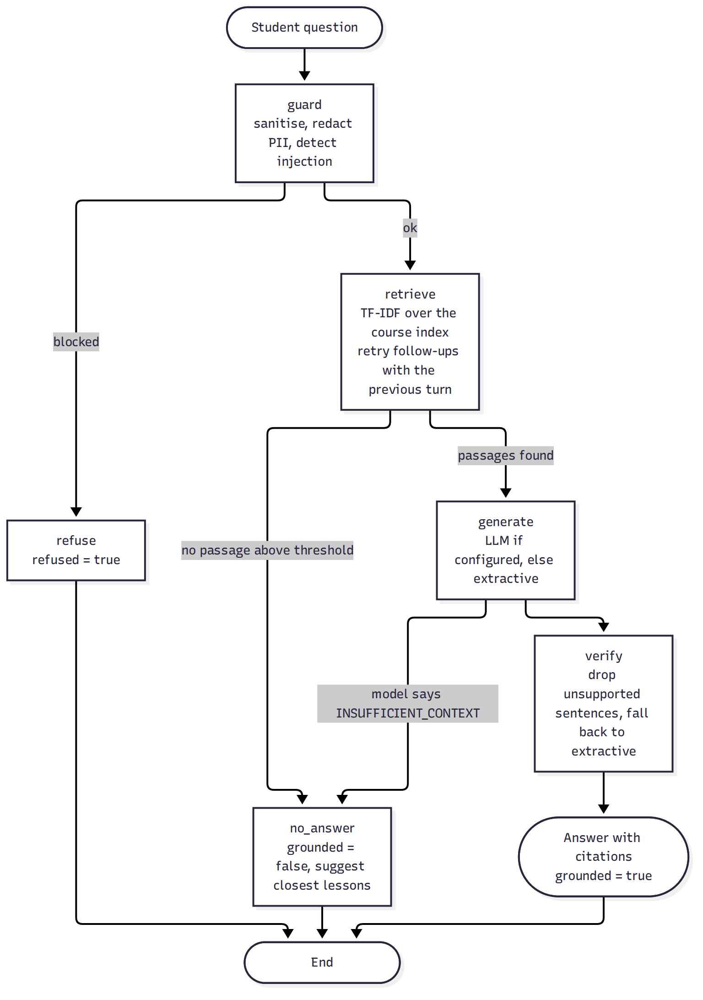

# AI design

The AI service (`ai-service/`) is a separate FastAPI process. It works fully **offline** (no key, deterministic) and can use an OpenAI-compatible or Azure OpenAI model for generation. Retrieval is always local.

## Pipelines (LangGraph)

| Graph | Nodes | Notes |
|---|---|---|
| **Tutor** | guard → retrieve → generate → verify, with exits `refuse` and `no_answer` | conditional routing; see diagram below |
| **Quiz** | load index → generate → validate | LLM JSON if available, otherwise deterministic cloze generation; every question re-validated |
| **Planner** | rules → explain | selection is rule based; the LLM (optional) only rephrases the summary |
| **Studio** | outline | groups playlist lessons into modules (explicit "Week N" markers, else parts of about six) and tags topics |

## Retrieval

* Lesson text (description + notes) is split into overlapping sentence windows (≈ 600 characters). Each chunk keeps lesson id, title, order and topics; title and topics are indexed with the text.
* A **per-course TF-IDF model** (unigrams + bigrams, light stemming) is fitted at ingest. Chunks store sparse vectors in MongoDB (`ai_chunks`), the model in `ai_models`. Questions are scored by cosine similarity, with a small boost for the lesson the student is viewing.
* Words in the question that never occur in the course **dilute** the score, so a question matching only one rare word does not look like a perfect match. Conversational filler ("hi", "please", "can you help me understand") is ignored.
* Below the threshold (`MIN_RETRIEVAL_SCORE`, default 0.12) the tutor declines and lists the closest lessons instead of guessing.
* Follow-ups ("and what about durability?") are retried with the previous question **only** when the standalone question misses and looks like a follow-up, so a short *new* question is never tied to the previous topic.

## Guardrails

| Stage | Control |
|---|---|
| Input | length cap (500), control-character removal, **prompt-injection patterns** (override, reveal prompt, role-play, fake `</system>`), **PII redaction** (emails, phone numbers including `+91 98765 43210`, 12-digit ids) |
| Prompt | passages are data: the system prompt tells the model to ignore instructions inside them and to answer `INSUFFICIENT_CONTEXT` when the passages do not contain the answer |
| Output | each sentence must be lexically supported by the retrieved passages (≥ 60 % of its content words); unsupported sentences are removed; if nothing survives, the extractive answer is used; markup is stripped |
| Quiz | structural validation (2-6 distinct options, valid answer index); results stored as **draft** for human review |

## Providers

`LLM_PROVIDER=offline|openai|azure` (`ai-service/.env.example`). `openai` works with any OpenAI-compatible endpoint (`LLM_BASE_URL`); `azure` uses the deployment URL and `api-key` header. Provider code is covered by tests against a mocked HTTP transport; **it has not been run against a live provider**.

## Measured quality

`docs/evaluation-results.md` (regenerate with `npm run eval:ai`) on the seed catalogue (32 lessons; 37 in-scope questions, 12 out-of-scope, 8 injection attempts):

| Metric | Result |
|---|---|
| Correct lesson ranked first / in top 3 | 97.3 % / 100 % |
| Out-of-scope questions declined | 100 % |
| Prompt-injection attempts refused | 100 % |
| Answer sentences found verbatim in the course text | 100 % |
| Offline quiz questions structurally valid / traceable to source | 100 % / 100 % (96 questions) |
| Tutor latency in-process (p50) | ≈ 3 ms |

**Read these honestly.** The questions were written by the project author against the same notes the index is built from, so they are a regression baseline, not a benchmark. One in-scope question ("How is HAVING different from WHERE?") scores 0.068, below the 0.12 default and below the strongest out-of-scope question (0.087), so it is declined (with the closest lesson suggested); lexical retrieval cannot separate those two perfectly. The default prefers a polite "not found" over a wrong answer.

## Limits and responsible use

* Offline answers are extracted sentences: accurate and cited, but not conversational. A hosted model reads better and still passes through the support filter.
* Offline quizzes are cloze questions with plausible distractors drawn from the course; always review drafts.
* Student questions are processed locally in offline mode. With a hosted provider, questions (after PII redaction) and retrieved passages are sent to that provider; disclose this to users and check your institution's policy.
* The tutor only knows what instructors put in lesson notes. Empty notes mean empty answers; the admin *content gaps* report shows what students asked that the notes could not answer.
