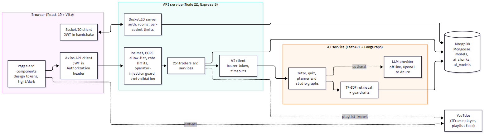
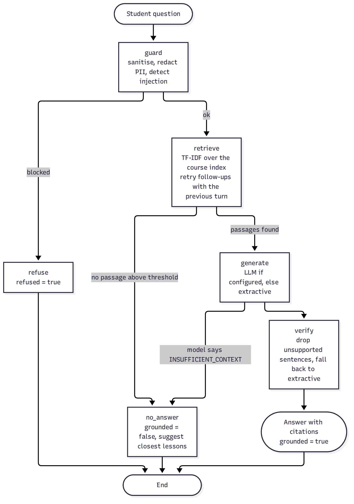
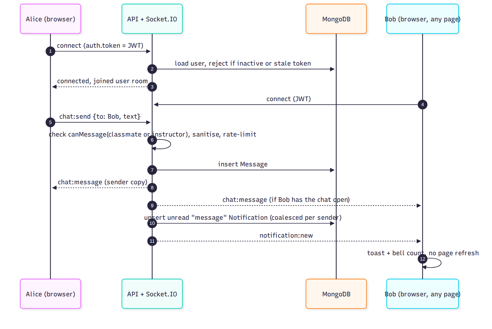

# Architecture

## Components

| Component | Responsibility | Talks to |
|---|---|---|
| **Web client** (`client/`) | UI, routing, session (JWT in `localStorage`), one Socket.IO connection owned by `RealtimeContext` | API over HTTPS and WebSocket; YouTube IFrame player |
| **API** (`server/`) | Authentication, authorisation, validation, business rules, persistence, real-time hub, AI gateway | MongoDB, AI service, YouTube feed/API |
| **AI service** (`ai-service/`) | Retrieval over course notes, tutoring, quiz drafting, study-plan composition, outline suggestions | MongoDB (its own `ai_chunks`, `ai_models` collections), optional LLM provider |
| **MongoDB** | System of record | |

The browser never talks to the AI service. The API authenticates the user, checks enrolment, then calls the AI service with a shared service token. The AI service never decides authorisation.

## Request path (every REST call)

`request id` → `logger` → `helmet` → `CORS allow-list` → `gzip` → `JSON (256 kB)` → global rate limit → **operator-injection guard** → route → `requireAuth` (JWT verified, user re-loaded from MongoDB: deleted/deactivated users and tokens older than a password change are rejected) → `requireRole` → **zod schema validation (strict)** → controller → `errorHandler` (structured JSON, request id, no internals).

## Key flows

### Study plan (adaptive)

1. A student submits a quiz. The API grades it **on the server** and folds each answered topic into `TopicMastery` with an exponentially weighted average (see `docs/data-model.md`).
2. `GET /ai/plan/:courseId` gathers lessons, completed lesson ids, mastery rows and the student's weekly hours, and sends them to the AI service.
3. The planner is **rule based and deterministic**: revisit weak topics (mastery < 60 %, ranked by weakness and staleness), practise topics studied but never assessed, then advance through the next lessons, trimmed to the weekly time budget. An LLM, if configured, may only rephrase the summary sentence.
4. The API caches the plan with a signature of the inputs; new progress or quiz results change the signature and regenerate it. If the AI service is down, the last saved plan is served and marked stale.

### AI tutor

Answers are built only from retrieved lesson text and always carry citations. Details and measurements: `docs/ai-design.md`, `docs/evaluation-results.md`.

### Real-time chat and notifications

Notifications are persisted first and then pushed, so a student who is offline sees them on the next visit. Direct-message notifications are coalesced into one unread item per sender with a running count.

## Design decisions

| Decision | Reason | Trade-off |
|---|---|---|
| Single Express app with a service layer, not microservices | Small team, one deployable, simple transactions | The AI service is the only separate process, because it has a different runtime (Python) and a different scaling profile |
| MongoDB with referenced documents | Matches the brief; flexible lesson/quiz shapes | Cascades (course/student delete) are several writes, not one transaction |
| `LearningProgress` stores completed lesson **ids**, not a counter | Idempotent: marking a lesson twice cannot inflate progress; deleting a lesson recomputes correctly | Slightly larger documents |
| Quiz grading and answer keys stay on the server | The original returned answers to the browser | One extra request after submitting |
| AI quizzes are saved as **drafts** | Generated content must be reviewed | Admin has a publish step |
| Lexical TF-IDF retrieval, no embedding model | Runs offline, explainable, no vendor lock-in, fast (p50 ≈ 3 ms in the evaluation) | Misses paraphrases that share no vocabulary; a dense retriever is the natural upgrade |
| Strict zod schemas (`.strict()`) | Unknown fields are rejected, which also prevents mass assignment | Clients must send exactly the documented fields |
| JWT in `localStorage` | Required by the brief, simple for SPA + separate API origin | Exposed to XSS; mitigated by React escaping, no `dangerouslySetInnerHTML` (tested), and a strict CSP. See `docs/security.md` |
| Same-origin proxy (Vite/nginx) in dev and Docker, absolute `VITE_API_URL` on Vercel | Avoids CORS locally | Production across origins relies on the CORS allow-list |

## Failure behaviour

| Failure | What happens |
|---|---|
| AI service down or unconfigured | `503` with a plain message on tutor/plan/quiz-generation; study plan falls back to the last saved plan; all other features unaffected; `GET /api/health/ready` reports `ai: down` |
| LLM provider error or hallucinated output | The graph falls back to the extractive answer built from retrieved text |
| MongoDB unavailable | `503`, readiness reports `degraded`; liveness stays `200` so the platform does not restart-loop |
| Socket disconnected | UI shows an offline hint and sends chat over `POST /messages`; Socket.IO reconnects automatically |
| Expired or revoked token | API returns `401`; the client clears the session and shows sign-in |
| Unexpected exception | Generic `500` body with a request id; details only in the server log |

## Scaling notes

The API is stateless apart from Socket.IO rooms. To run more than one API instance, add the Socket.IO Redis adapter and sticky sessions; this is **not implemented**. Retrieval scans one course's chunks in memory (a few thousand at most); for very large corpora use MongoDB Atlas Vector Search or a dedicated index.
