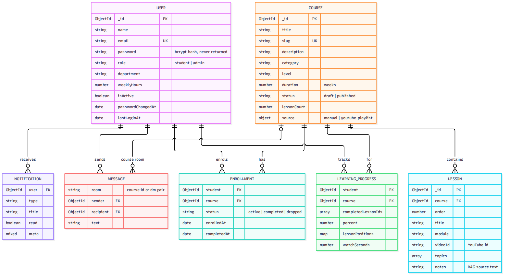
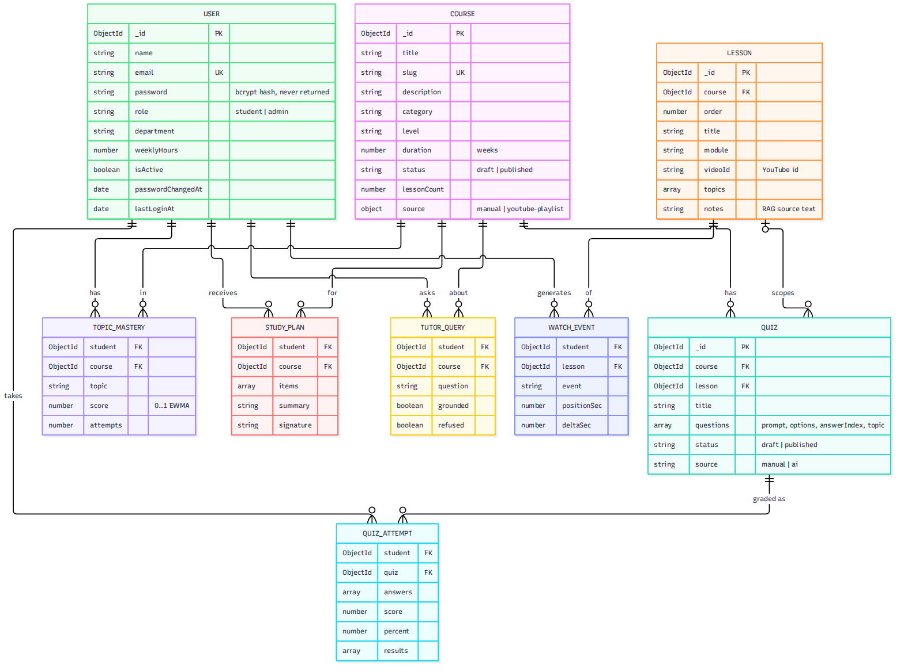

# Data model (Task 11)

13 Mongoose models in `server/src/models`. Schemas enforce types, enums, lengths and indexes; the API additionally validates every request with zod before it reaches a model.

## ER diagrams

**Core entities**



**Assessment, personalisation and telemetry**



Full single-diagram version: `diagrams/er-full.png` (Mermaid sources: `diagrams/*.mmd`).

## Collections

| Collection | Purpose | Key constraints and indexes |
|---|---|---|
| `users` | Students and admins | `email` unique, lower-cased; `password` is a bcrypt hash with `select:false`; `role` ∈ student/admin; `passwordChangedAt` invalidates older tokens |
| `courses` | Catalogue | `slug` unique; `status` draft/published; `duration` is in **weeks**; text index on title/description/tags; `(status, category, createdAt)` index |
| `lessons` | Units of a course | `(course, order)` index; `videoId` must be an 11-character YouTube id; `notes` ≤ 20,000 chars is the source text for the AI tutor |
| `enrollments` | Student ↔ course | **unique** `(student, course)`; status active/completed/dropped (unenrol is soft so progress survives re-enrolment) |
| `learningprogresses` | Per-student course progress | **unique** `(student, course)`; set of completed lesson ids, derived `percent`, resume positions map, watch seconds |
| `quizzes` | Question sets | 1–50 questions, 2–6 options each, `answerIndex` must be in range; `status` draft/published; `source` manual/ai |
| `quizattempts` | Graded submissions | score, percent, per-question result with topic |
| `topicmasteries` | Mastery model | **unique** `(student, course, topic)`; `score` ∈ [0,1] |
| `studyplans` | Cached AI plan | **unique** `(student, course)`; `signature` of the inputs |
| `notifications` | In-app notifications | `(user, read, createdAt)` index; `meta` carries sender/count for coalesced messages |
| `messages` | Chat | `room` is `course:<id>` or `dm:<idA>:<idB>` (ids sorted); `(room, createdAt)` index |
| `tutorqueries` | Tutor telemetry | grounded/refused flags drive the admin *content gaps* report; TTL 180 days |
| `watchevents` | Engagement events | TTL 90 days; aggregated into `learningprogresses` |

The AI service additionally owns `ai_chunks` (indexed lesson passages with sparse TF-IDF vectors) and `ai_models` (per-course IDF), rebuilt on every lesson change or `POST /admin/courses/:id/reindex`.

## Relationships and delete rules

* Deleting a **course** removes its lessons, enrollments, progress, quizzes, attempts, mastery, plans, tutor queries, watch events and its chat room.
* Deleting a **student** removes their enrollments, progress, attempts, mastery, plans, tutor queries, watch events, notifications and messages.
* Deleting a **lesson** recomputes progress for everyone who had completed it.
* Multi-document deletes are not wrapped in a transaction (they are idempotent and can be re-run).

## Mastery formula

For each answered question on topic *t*, with outcome `o` = 1 (correct) or 0:

```
mastery(t) ← mastery(t) + 0.35 × (o − mastery(t))        # prior = 0.5 for a never-assessed topic
```

Recent answers dominate (a student who improves recovers quickly), the value stays in [0,1], and it is unit-tested (`server/tests/learning.test.js`). The planner treats a topic as **weak** below 0.60.

## Seed data

`npm --prefix server run seed` (or `SEED_ON_BOOT=true`) creates, idempotently, three published courses (32 lessons, 4 quizzes):

1. *Introduction to Database Systems*, 16 lessons whose titles follow the public NPTEL-NOC IITM lecture list.
2. *Machine Learning Foundations*, 8 lessons.
3. *Data Structures Essentials*, 8 lessons.

Study notes and quiz questions are original summaries written for this project. Re-running never overwrites edits.
