# User guide

Screenshots were captured automatically by the browser tests (`npm run test:e2e`) from the running application.

## Students

### 1. Browse and enrol
Anyone can browse the catalogue; search, filter by category/level and sort. Open a course to see its curriculum, then **Enrol** (you must be signed in).

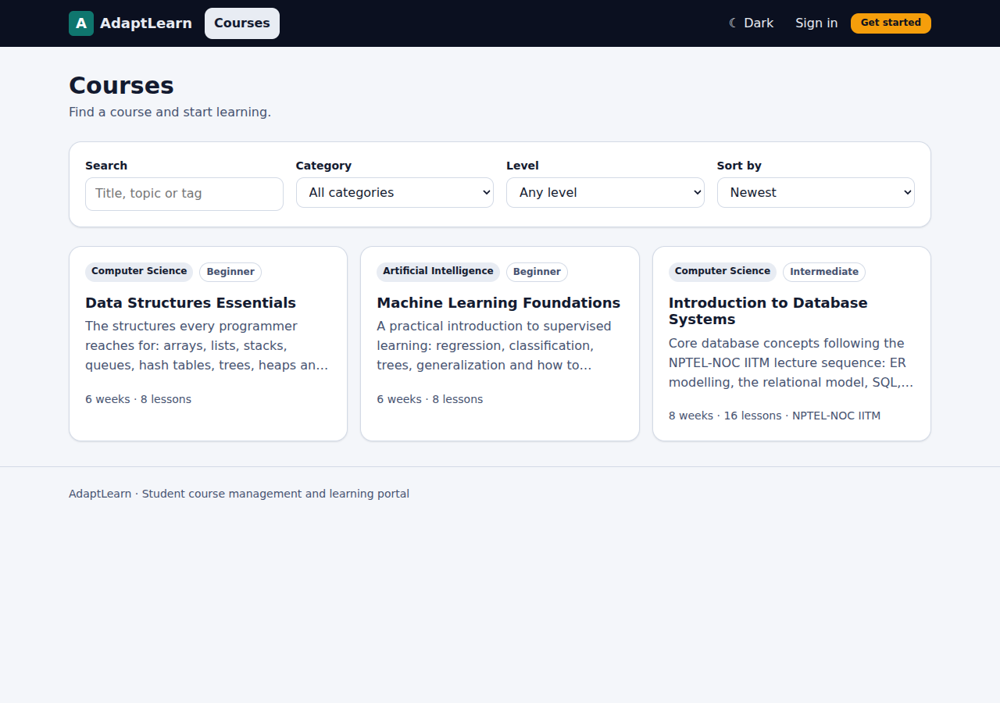

### 2. Learn
Open a lesson from the course page or **Continue learning**. Each lesson has the video (when attached), **study notes**, **Mark as complete**, and previous/next navigation. Playback position is saved so you can resume.

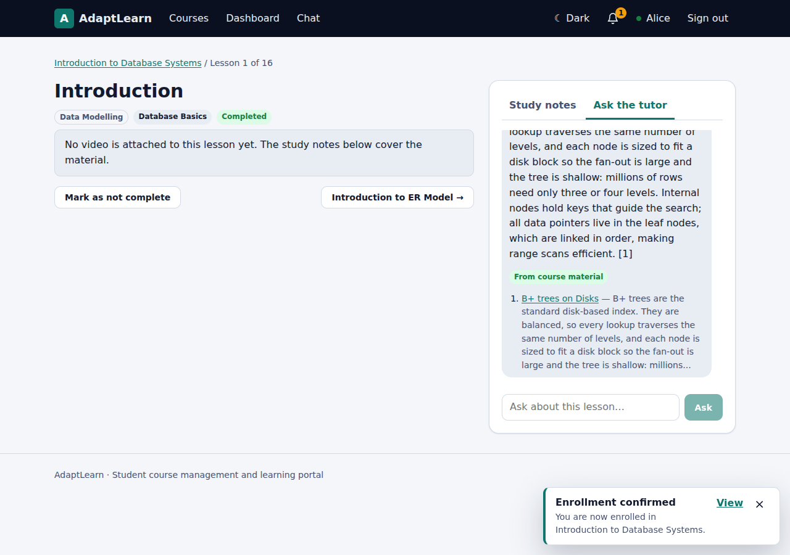

### 3. Ask the AI tutor
On a lesson page choose **Ask the tutor**. Answers come only from your course notes and show the lesson they came from (click to open it). If the notes do not cover the question you will see *Not in course material* and the closest lessons, rather than a guess.

### 4. Take quizzes
On the course page, **Start** a quiz, answer, and **Submit**. You see your score and, for each question, the correct answer and an explanation. Retake as often as you like; your best score is shown.

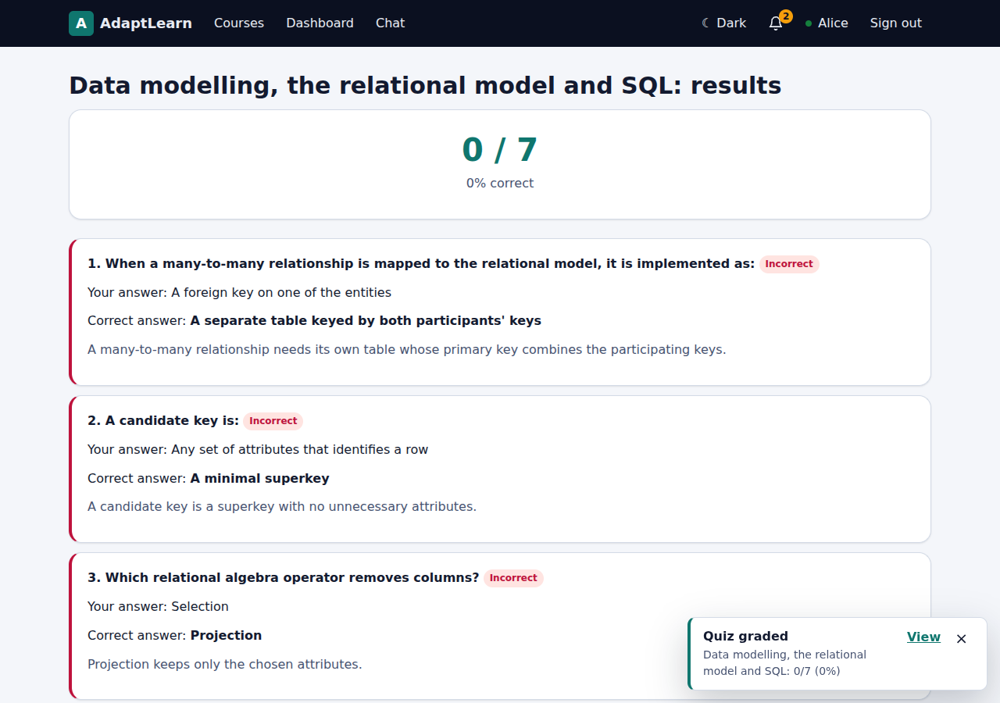

### 5. Follow your study plan
The **Dashboard** shows your progress and a plan sized to your weekly hours (set it in *Profile*): topics to **revisit** (with the evidence, such as "Mastery of SQL is 21 % after 2 answered questions"), topics to **practise**, and the **next lessons**. It updates after every quiz or lesson.

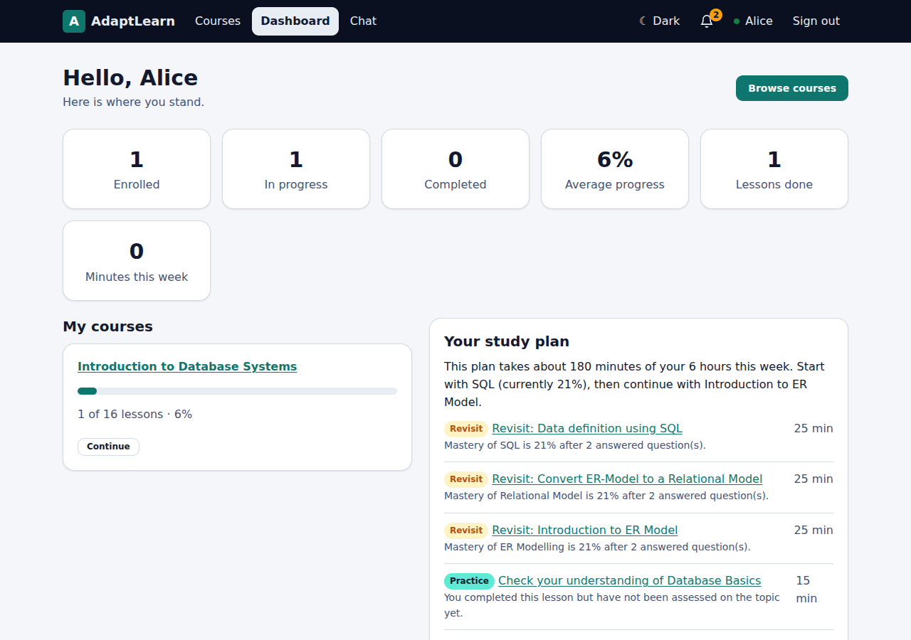

### 6. Chat and notifications
**Chat** has a room per enrolled course and direct messages with classmates and instructors. Messages arrive instantly. The bell shows unread notifications (enrolment, quiz results, new courses, announcements, messages) and a toast appears on any page.

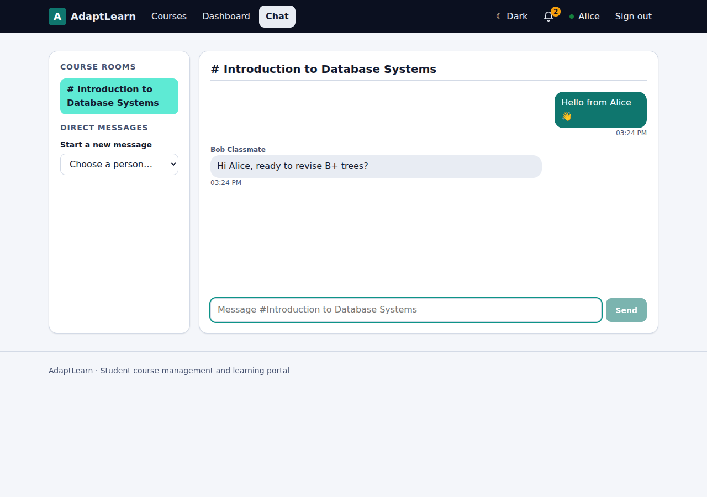
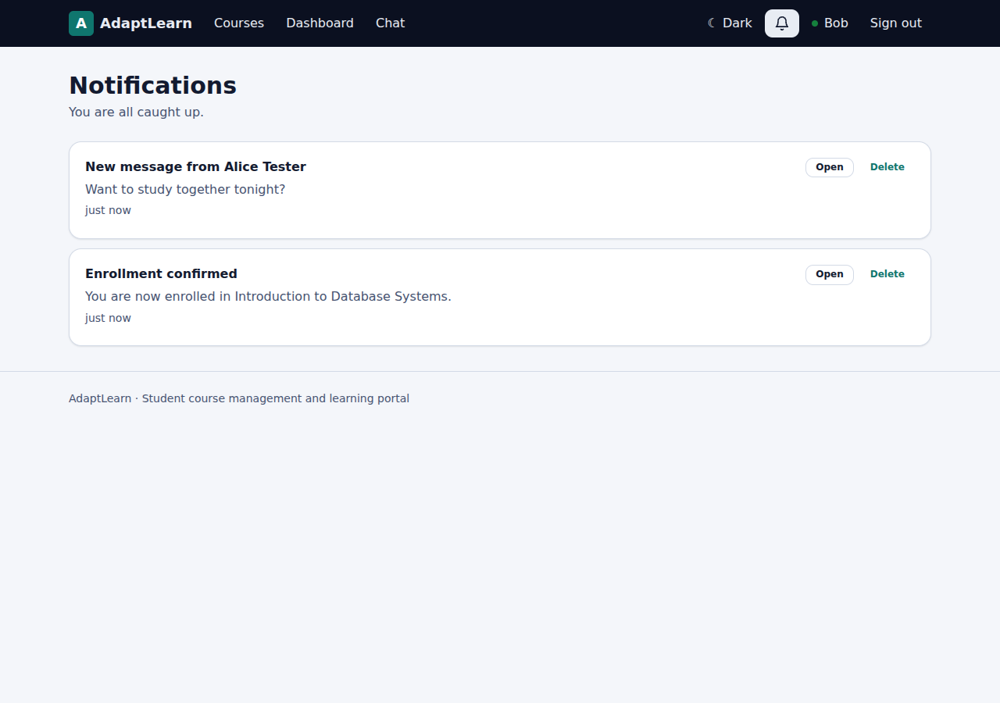

### 7. Theme and phone
The **Dark** button switches theme (remembered). The layout adapts to phones.

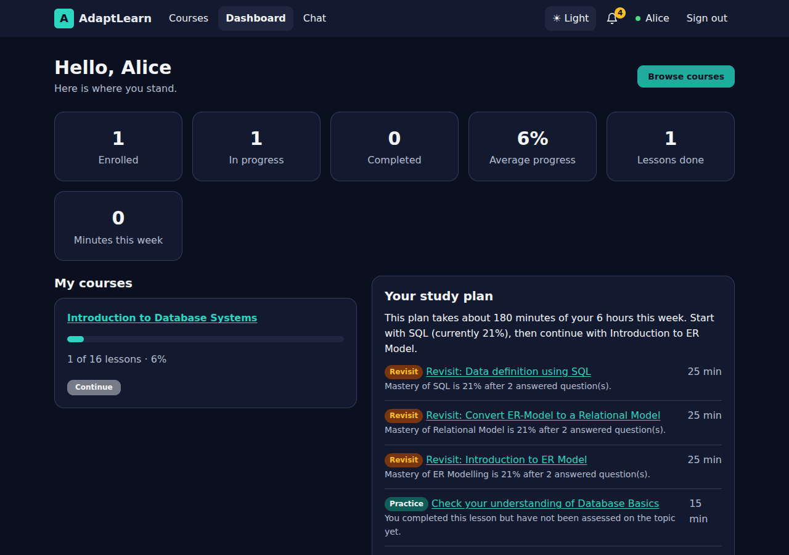

## Administrators

Sign in with the account configured in `ADMIN_EMAIL`. The navigation shows **Catalog** (what students see), **Overview**, **Courses**, **Students**, **Studio**.

### Overview
Platform statistics, **Students at risk** (inactive for 7+ days, low quiz mastery, or slow start, each with the reason), **Content gaps** (questions the tutor could not answer: add that material to the lesson notes), and an announcement composer for all students or one course.

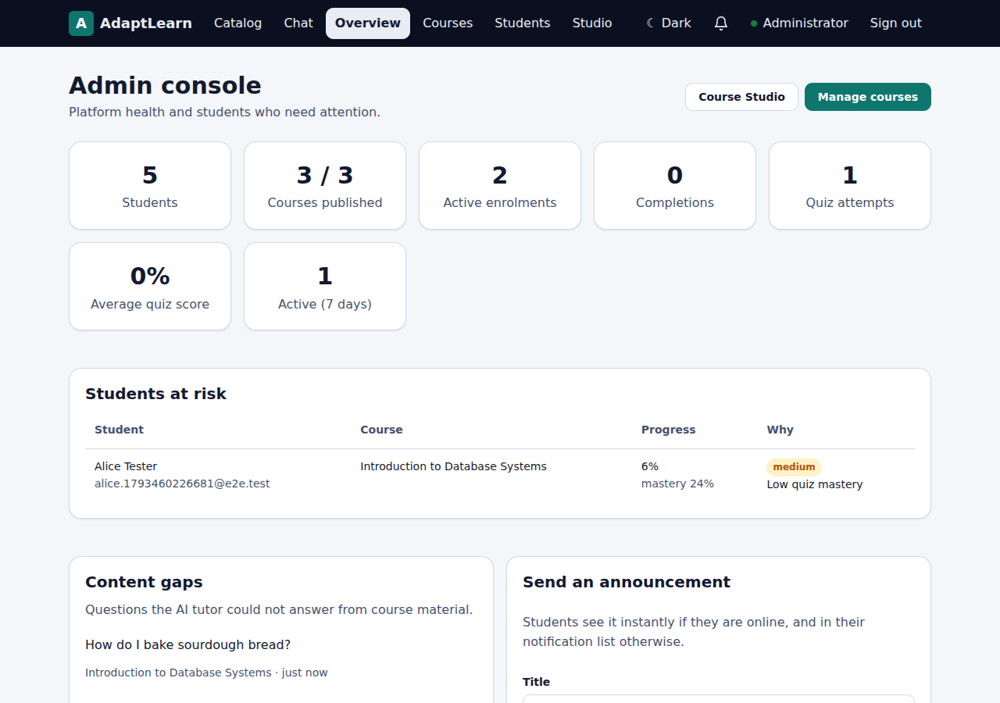

### Courses
Create a course (it starts as a **draft**), edit details, add lessons (title, module, YouTube video id, topics, **study notes**), then **Publish**; students are notified. Deleting a course removes everything attached to it (with confirmation).

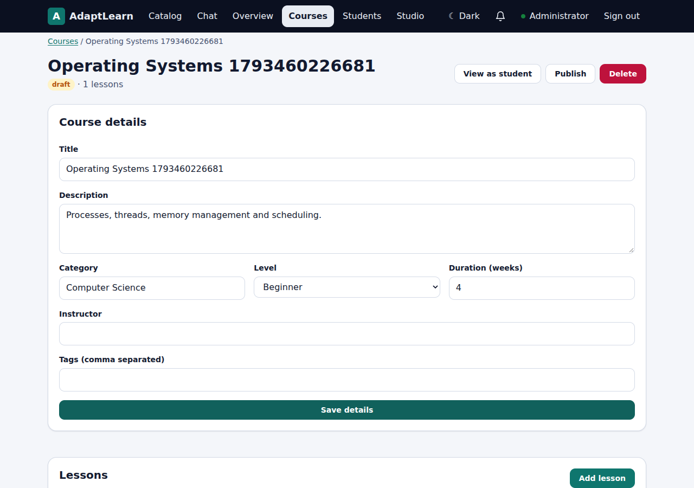

* **Attach videos from a YouTube playlist:** paste a public playlist URL; videos are matched to lessons by title and unmatched lessons are left alone.
* **Quizzes:** **New quiz** opens a form to write questions by hand (2-6 options, mark the correct one, add a topic and explanation). **Generate draft** creates an AI draft from the whole course or one lesson; click **Review** to read and edit every question, then **Publish**. Students never see drafts.

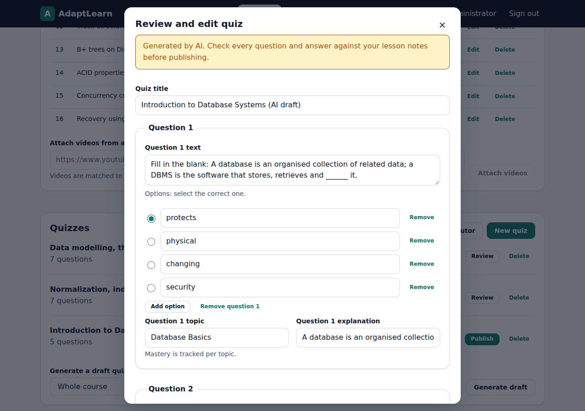
* **Re-index for AI tutor:** refreshes what the tutor can retrieve (happens automatically when lessons change).

### Students
Search, add, edit (name, email, department, active flag, password reset) and delete students. Deactivating signs the student out immediately.

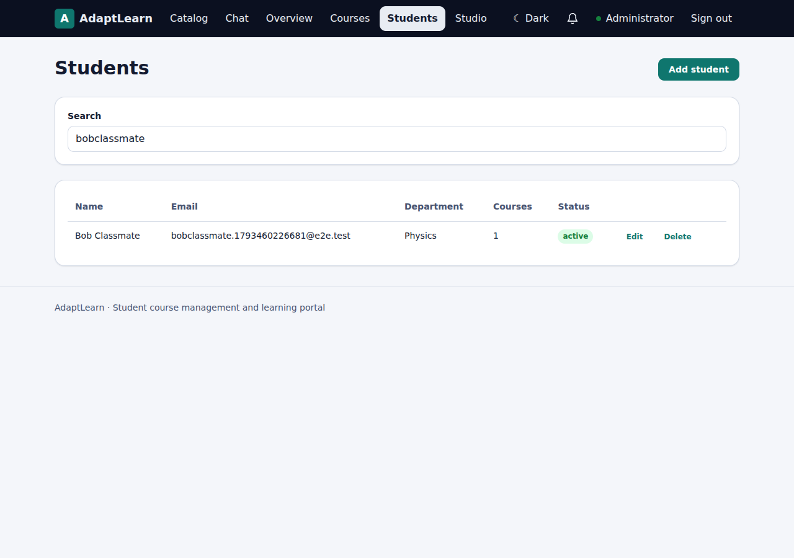

### Studio
Paste a public YouTube playlist URL, preview its videos, set title/category/level and create a course whose lessons are the videos (optionally published at once). When the AI service is running, lessons are also grouped into modules and tagged with topics.

## Tips for good tutor answers

* Put real explanatory text (or the video transcript) in each lesson's **Study notes**; the tutor can only use what is there.
* Give lessons **topics**; quizzes, mastery and the study plan are organised by topic.
* Check **Content gaps** weekly and fill them in.
